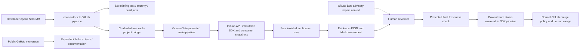
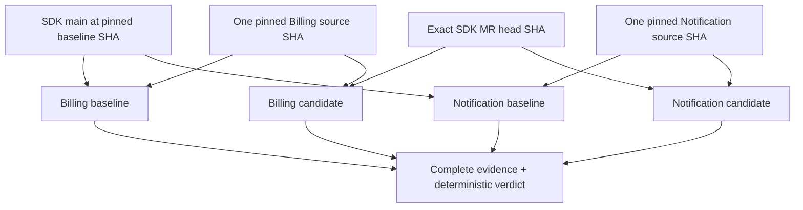
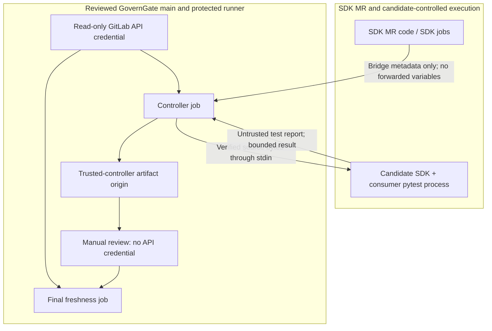
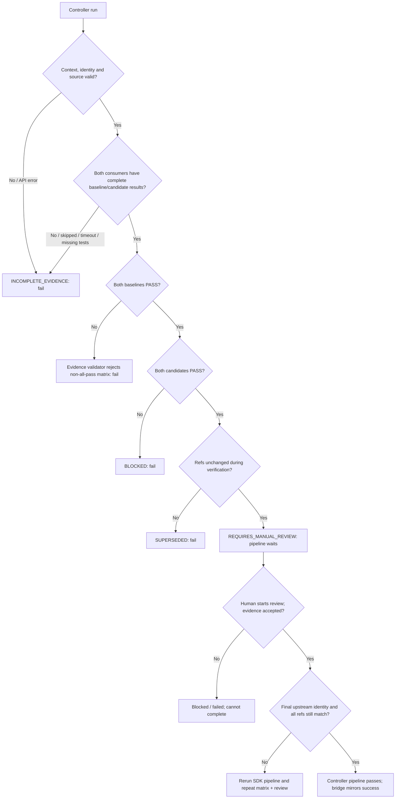

# GovernGate architecture and flow diagrams

Updated October 21, 2026. This describes the deployed GitLab controller at `84e6779625460fe29406a5a15c9949f4ee1b206c`, preserved in GitHub main by [PR #3](https://github.com/devothamgn321/governgate-autonomous-release-governance/pull/3), merge `cc4f876f6f2df6dc7688ad51e248a7d40486dc09`. Documentation changes after that snapshot do not imply a new controller deployment.

## What it does

A shared authentication SDK can pass its own tests and still break a service that uses it. GovernGate tests the exact proposed SDK source against two fixed consumers, compares the results with the current SDK baseline, and makes that evidence part of the SDK merge-request pipeline. It never merges a change automatically.

## System context



GitLab is the operational CI system. GitHub preserves source and runs local tests; it does not recreate GitLab environment protection, variables, memberships, runners or Duo configuration. Duo is advisory: the controller always tests both known consumers, regardless of static predictions. Nebius is optional and disabled pending approved access; it is not in the deployed gate's critical path.

## Components and ownership

| Component | Implementation | Responsibility |
| --- | --- | --- |
| SDK bridge | `core-auth-sdk/.gitlab-ci.yml`, `governgate/templates/governgate-check.gitlab-ci.yml` | Starts protected controller main, mirrors downstream status, forwards no variables |
| Trusted orchestration | `governgate/controller.py` | Validates context and upstream identity, snapshots source, runs fixed consumer matrix, writes evidence |
| GitLab API access | `governgate/gitlab_client.py` | Reads repository and pipeline metadata, paginates trees; redirects rejected |
| Worker image and execution | `ci/Dockerfile.worker`, `worker.py`, `worker_results.py` | Uses fixed dependencies, loads verified pure Python SDK source, runs pinned consumer tests, checks expected test coverage |
| Evidence ledger | `governgate/evidence_ledger.py` | Seals evidence with a SHA-256 integrity digest; optional HMAC capability is not demonstrated in the live gate |
| Manual review and final check | `governgate/manual_review.py` | Validates complete all-pass evidence; final mode rechecks upstream relationship and moving refs |
| CI stages | `.gitlab-ci.yml` | Test, verify, blocking manual review, finalize |
| SDK consumers | `billing-service/billing/payments.py`, `notification-service/notifications/sender.py` | Billing verifies tokens; Notification issues tokens |
| Legacy engine modules | Semantic analyzer, consumer discovery, differential verifier, policy, remediation, AI clients | Available prototype capabilities; not the fixed-consumer protected controller execution path |

The current controller's verdict function is `controller.verdict`. Do not confuse the legacy `policy_engine` or optional AI remediation path with the active gate. The live controller does not install the uploaded SDK wheel: it verifies immutable source bytes and supplies those to the worker. The SDK wheel and its checksum/source marker remain separate build evidence.

## Pipeline sequence

```mermaid
sequenceDiagram
  actor Dev as SDK developer
  participant SDK as SDK MR pipeline
  participant GL as GitLab API
  participant GG as Protected controller
  participant W as Isolated workers
  actor Human as Reviewer
  participant Final as Protected freshness job
  Dev->>SDK: Open/update same-project MR targeting main
  SDK->>SDK: Six existing test/security/build jobs
  SDK->>GG: Bridge to main, strategy mirror, no forwarded variables
  GG->>GL: Validate upstream project/pipeline/bridge/downstream relationship
  GG->>GL: Resolve exact detached MR head and current main baseline
  GG->>GL: Paginate trees; verify pinned source archives and file hashes
  loop Billing and Notification, each against baseline and candidate
    GG->>W: Verified source bytes + immutable worker image ID
    W-->>GG: Exit status, expected-test summary, bounded log
  end
  GG->>GL: Recheck SDK head, target and consumer refs
  GG-->>Human: Evidence artifact and Markdown report
  alt Complete all-pass matrix
    Human->>Human: Inspect trusted evidence and candidate change
    Human->>SDK: Start blocking manual-evidence-review job
    SDK->>SDK: Validate ledger and all-pass identities without API credential
    SDK->>Final: After successful manual review
    Final->>GL: Re-resolve upstream identity and compare all current refs
    Final-->>SDK: Success only if evidence is still current
  else Candidate regression, incomplete evidence or moved source
    GG-->>SDK: Failure; no approval path
  end
  SDK-->>Dev: Mirrored downstream status
```

The manual job runs in the GovernGate pipeline; its success permits finalization, not automatic merge. If any relevant ref changes, rerun the SDK pipeline to rebuild all evidence and repeat review. Retrying only the final job does not validate new source.

## Verification matrix



Consumer discovery here is a fixed allowlist of Billing and Notification project IDs. Generic discovery exists in the legacy modules but is not a claim of live organization-wide onboarding. Baseline is current SDK target `main`, not an old merge base. A verifier-only regression should fail Billing's candidate while Notification remains compatible; control behavior is observed, not assumed.

## Trust boundary and credentials



`GOVERNGATE_API_TOKEN` belongs only in the GovernGate project as a protected, masked variable scoped to `governgate-controller`, with read-only API permissions limited to the needed repositories. Fine-grained token permission names must match the endpoints used by this implementation. No personal broad-scope PAT or Nebius secret belongs in SDK/MR jobs. The credential's current value/type is not part of this source snapshot. Never put it in documentation, artifacts, URLs or logs.

Both controller and final job require expected project ID, protected `main`, and pipeline source `pipeline` before API access. The controller verifies GitLab's actual upstream bridge/downstream relationship instead of trusting arbitrary MR IID/SHA inputs. Only open same-project SDK MRs targeting main and detached MR pipeline identity are supported. Fork requests and arbitrary repositories are outside this demo's supported path.

Workers receive no API credential, signing key, host mounts, Docker socket or network. Containers use a read-only root, dropped capabilities except privilege-drop setup, no-new-privileges, bounded processes/memory/CPU, a temporary filesystem and timeout/output limits. The wrapper starts with enough privilege to prepare read-only inputs; it drops pytest to UID/GID 65534. The reviewed controller uses Docker-in-Docker; the runner host and daemon remain trusted infrastructure, not independently audited isolation.

Worker dependencies are built into the reviewed image. Candidate build scripts and consumer requirements are not installed. This supports the current pure Python SDK layout; arbitrary native dependencies or additional languages need a separate design.

## Source verification and evidence lifecycle

```mermaid
flowchart LR
  Commit[Full immutable commit SHA] --> Tree[Read every repository-tree page]
  Tree --> Metadata[Per-file commit and SHA-256 metadata]
  Metadata --> Archive[Download pinned ZIP, reject redirects]
  Archive --> Validate[Validate paths / complete file set / hashes / size limits]
  Validate --> Inputs[Read-only source bytes packed for workers]
  Inputs --> Runs[Four worker results]
  Runs --> Record[SDK and consumer identities + image ID + outcomes]
  Record --> Seal[SHA-256 sealed evidence JSON]
  Seal --> Manual[Human inspection + schema/integrity validation]
  Manual --> Freshness[Final live ref checks]
```



Archives reject duplicate/unexpected/missing files, unsafe paths, unsupported file modes, excessive size and unsupported tree entries. The controller records archive SHA-256 digests, commits, image ID, run summaries and limitations in `governgate-evidence.json`; `governgate-report.md` is the readable summary. CI retains these artifacts for 90 days. Download important evidence before expiry.

SHA-256 integrity is not an independent authenticity signature. Candidate code shares the process producing JUnit and can forge report contents. Expected-test checks reject simple empty/early-exit/skip cases, but they do not solve independent result attestation. Review the artifact from the trusted controller job, not a candidate-supplied replacement.

## Decision and completion states



Implementation detail: `controller.verdict` initially returns REQUIRES_MANUAL_REVIEW for a failed baseline, but the controller immediately applies the all-pass evidence validator, which rejects it; the written final result becomes INCOMPLETE_EVIDENCE. Source movement can override a provisional verdict with SUPERSEDED. A passing CI pipeline is a point-in-time result and does not freeze refs or guarantee an atomic merge.

## Verified deployment versus future work

| Area | Verified checkpoint / limit |
| --- | --- |
| Protected controller, blocking review and final freshness | Deployed through GovernGate MR !6; positive and negative live evidence recorded October 21 |
| Local monorepo suite | 128 passed: SDK 11, Billing 5, Notification 3, GovernGate 109 |
| Public mirror | PR #3 merged; main push workflow 39681631899 passed |
| Existing SDK six jobs and Duo | Preserved; Duo advisory, not gate authority |
| Nebius | Optional, disabled; no approved live API call claimed |
| Independent result attestation | Not implemented; human review remains required |
| Ref movement | Regression tests cover it; no live ref-movement experiment claimed |
| Legacy signature analyzer | Disabled legacy path has optional-parameter insertion edge case; active fixed-consumer controller does not depend on it |
| Enterprise scale / arbitrary consumers | Not validated; current IDs, consumers, worker dependencies and layouts are fixed |

See the implementation runbook and live execution log for exact pipeline URLs. None of the diagrams claims automatic remediation, production deployment, automatic approval or automatic merge.
